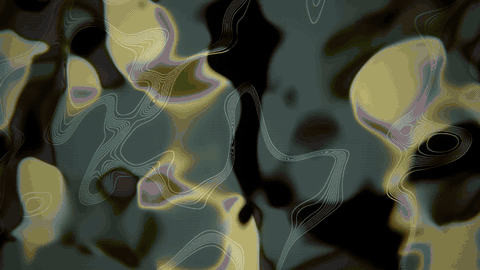
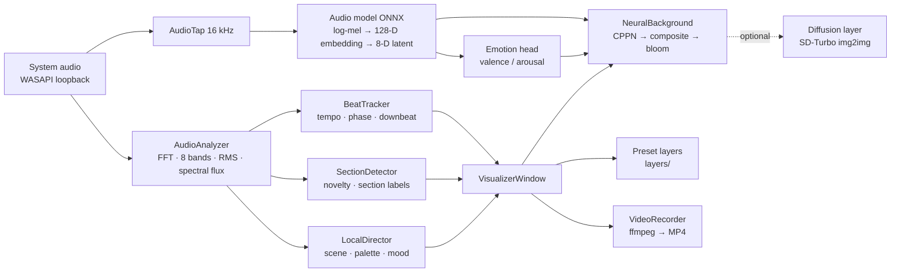

# AI Music Visualizer

[](https://github.com/4RD4024N/ai-visualizer/actions/workflows/tests.yml)

A real-time music visualizer for Windows. It captures whatever is playing on your system, follows the beat and the song's structure, and renders a GPU neural background driven by its own trained audio model. Everything runs locally; no LLM or network service is used.



## Highlights

- **Beat-locked visuals:** tempo + phase tracking (a phase-locked loop on the onset envelope) fires flashes, zoom pulses, scene and style changes exactly on the beat, with stronger hits on the downbeat.
- **Song structure:** detects section boundaries (intro, verse, chorus, drop, breakdown) and changes the visual world when the song does, instead of on a timer.
- **Own audio model:** a self-supervised CNN maps the spectrogram to an 8-D latent that drives a per-pixel CPPN shader. An emotion head trained on human annotations (DEAM) feeds the dream mode.
- **Video recording:** press **F9** to record the visuals with system audio to an MP4.
- **Settings menu + `config.json`:** press **S**; changes apply live and are saved.
- **Standalone `.exe`:** built with PyInstaller, no Python needed to run it.

## Quick Start

1. Make the system audio capturable: enable **Stereo Mix** in Windows sound settings, or install a virtual cable such as VB-Cable.
2. Run it:

```
pip install -r requirements.txt
python visualizer.py
```

Or build the standalone version (see [Packaging](#packaging)) and run `dist/AIVisualizer/AIVisualizer.exe`.

For recording, `ffmpeg` must be on PATH (`winget install Gyan.FFmpeg`).

## Architecture



| Module | Role |
|---|---|
| [visualizer.py](visualizer.py) | Window, update/draw loop, input, wiring |
| [audio_analyzer.py](audio_analyzer.py) | Capture, FFT bands, spectral flux; feeds the beat and section trackers |
| [beat.py](beat.py) | Tempo, beat phase, downbeat |
| [structure.py](structure.py) | Section boundary detection and labels |
| [director.py](director.py) / [palette.py](palette.py) | Scene, palette and mood decisions; color transitions |
| [layers/](layers/) | Preset shape layers (pyglet shapes) |
| [neural_bg.py](neural_bg.py) | CPPN + generative shader background, dream mode |
| [audio_model.py](audio_model.py) / [audio_features.py](audio_features.py) | Runtime audio model and shared feature extraction |
| [diffusion_layer.py](diffusion_layer.py) / [concepts.py](concepts.py) | Optional SD-Turbo scene layer with CLAP concept selection |
| [recorder.py](recorder.py) | MP4 recording |
| [config.py](config.py) / [settings_menu.py](settings_menu.py) | Settings file and on-screen menu |
| [train/](train/) | Training scripts (separate environment) |
| [tools/](tools/) | Device list, model metrics report |

## Beat Tracking

[beat.py](beat.py) works on the spectral flux of each audio block (~47 Hz):

1. **Tempo:** autocorrelation of the last 6 s of the onset envelope, with harmonic summation and a log-Gaussian prior around 120 BPM to avoid octave errors. Parabolic interpolation gives sub-frame precision.
2. **Phase:** a beat grid is predicted ahead of time. Each onset peak measures its error against the nearest grid point and nudges the grid (a phase-locked loop). Beats fire from the grid, so visuals hit *on* the beat rather than one detection-delay late.
3. **Confidence:** the share of recent beats that had a real onset. When confidence is low, a strong onset re-seeds the grid, and the visuals fall back to the older bass-rise trigger.
4. **Downbeat:** the slot of the 4-beat cycle with the most bass onset energy.

On synthetic click tracks from 90 to 174 BPM it locks within a few seconds, with a mean phase error under 40 ms (see [tests/test_beat.py](tests/test_beat.py)).

When locked (**beat sync** on), scene changes from the director wait for the next downbeat (at most 2.5 s), and neural style changes wait for one (at most 3 s).

## Song Structure

[structure.py](structure.py) averages features over 0.5 s segments (log band energies, log RMS, log onset strength) and z-scores them over the last 2 minutes, so it adapts to each song. *Novelty* is the distance between the last 2 s and the 6 s before them. A boundary is a novelty peak above an adaptive threshold (median + 4·MAD, so earlier peaks do not inflate it), at least 8 s after the previous one.

The new section is labeled by its energy relative to the song so far and by the energy jump:

| Label | Rule | Visual reaction |
|---|---|---|
| `drop` | big energy rise, high energy | shape rain, shockwaves, instant style change |
| `breakdown` | big energy fall | fast style change |
| `chorus` / `verse` / `calm` | upper / middle / lower energy | new style + next scene, on the downbeat |
| `intro` | after more than 2 s of silence | history reset |

The current section and beat position are shown in the HUD (`BPM:128 ●○○○  bölüm:chorus`).

## Scene Director

Every 3 seconds `LocalDirector` reads an audio snapshot (RMS, onset activity, dynamics, BPM, bass/treble balance) and computes an energy score. Levels are normalized against a slowly decaying peak, so it adapts to any volume or device. From that it picks:

- A scene: `minimal`, `cosmic`, `flow`, `web`, `galaxy`, `full` or `storm`. A new scene must win two checks in a row before it switches.
- A 4-color palette: bass-heavy music shifts warm, treble-heavy shifts cool. Higher energy gives more saturated, more contrasting colors.
- A background color, a mood label, complexity, animation speed, and shape-rain bursts on very intense moments.

## Neural Background (CPPN + Generative Shader)

The default visual mode is a neural background rendered entirely on the GPU (`neural_bg.py`):

1. **CPPN pass:** a small MLP (12→16→16→16→4) runs per pixel. Its inputs are the pixel coordinates (after kaleidoscope folding and domain warping), an 8-dimensional latent vector, and time.
2. **Composite pass:** the network output is mapped to the current palette gradient, a mask that leaves negative space, and contour lines. The previous frame is fed back with zoom, rotation and flow trails.
3. **Display pass:** mipmap bloom, chromatic aberration, ACES tone mapping, vignette and film grain.

A *style* is a set of network weights plus shader parameters. Styles change when the song enters a new section, on drops, and otherwise every 22–38 seconds. During a change the weights are interpolated, so one world morphs into the next.

The 8 latent dimensions come from the trained audio model (see below), which sets the song's overall character. Deviations in the 8 frequency bands are added on top for fast reactions. Without a model, the bands drive the latent on their own.

Styles saved with **K** go to `neural_styles/` and are mixed back into the rotation.

## Recording

**F9** starts and stops recording. Frames are read from the GPU after the scene is drawn (without the HUD unless *Kayda HUD dahil* is on) and streamed to ffmpeg (libx264) by a writer thread, so rendering never waits on the disk. The frame count follows the wall clock: if rendering is slower than the target FPS the last frame is repeated, if faster frames are skipped, so the video stays in sync with the audio. System audio is written to a WAV alongside and both are merged into `recordings/visualizer_YYYYMMDD_HHMMSS.mp4` when you stop.

To turn a clip into a README GIF:

```
ffmpeg -i recordings/clip.mp4 -t 5 -vf "fps=12,scale=480:-1:flags=lanczos,split[a][b];[a]palettegen=max_colors=64[p];[b][p]paletteuse" docs/demo.gif
```

## Settings

Press **S** for the on-screen menu (↑↓ select, ←→ change, R reset, S close). Every change applies immediately and is saved to `config.json` next to the app. The file can also be edited by hand; unknown keys are ignored and invalid values fall back to defaults.

| Key | Default | Meaning |
|---|---|---|
| `width`, `height`, `fullscreen` | 1280, 720, false | Window (size is saved on exit) |
| `device` | `""` | Part of the input device name to force, e.g. `"CABLE"` (list devices with `python tools/list_devices.py`) |
| `sensitivity` | 1.0 | Input gain for visuals |
| `beat_sync` | true | Fire effects and transitions on the beat grid |
| `section_detection` | true | React to section changes |
| `flash`, `zoom_pulse` | 1.0, 1.0 | Beat effect strength |
| `palette_drift` | 0.025 | Slow hue rotation speed |
| `scene_duration` | 22 | Preset scene rotation (s) |
| `show_hud` | true | HUD visibility |
| `record_fps`, `record_crf`, `record_dir`, `record_hud` | 30, 18, `recordings`, false | Recording options |
| `lyrics`, `lyrics_model` | true, `openai/whisper-medium` | Listen to lyrics (Whisper) and put them into scenes |
| `lyrics_window`, `lyrics_step` | 4.0, 0.5 | Whisper window and step (s) |
| `lyrics_translate_first` | true | Turkish: generate the English translation first, in one pass (false = old order: transcribe + translate) |
| `lyrics_hud_original` | true | Turkish: generate the original text for the HUD afterwards, for new lines only |
| `lyrics_reuse_encoder` | true | Reuse the language-detection encoder output in `generate` |
| `lyric_priority`, `lyric_fade` | true, 0.06 | A new lyric line starts a scene without waiting for the minimum scene length; crossfade (s) of its first frame |
| `latency_log` | true | `[Gecikme]` log line per lyric line + HUD value |
| `diff_fast`, `diff_compile` | true, false | Diffusion speedups (channels_last + cudnn.benchmark + inference_mode) / `torch.compile` |

## Controls

| Key | Action |
|---|---|
| S | Settings menu |
| F9 | Start / stop recording |
| F | Fullscreen |
| TAB | Toggle HUD |
| H | Help overlay |
| + / − | Sensitivity |
| SPACE | Randomize palette |
| M | Mouse mode (off / attract / repel) |
| A / N | Auto scene rotation / next scene |
| R | Shape rain |
| 1–0, O | Toggle individual layers |
| G | Toggle neural background |
| B | Toggle preset shape layers |
| V | New style |
| K | Save current style to favorites |
| L | Lock / unlock current style |
| X | Toggle audio model (dream mode) |
| D, [ / ] | Diffusion layer on/off, diffusion noise level |
| C | Toggle live feature capture (for training) |
| ESC / Q | Quit |

## Audio Sources

The visualizer picks the input in this order:

1. The device named in `config.json` → `device`
2. Virtual cable output (e.g., VB-Cable)
3. Stereo Mix / What U Hear
4. Microphone fallback (if no loopback device is found)

## Frequency Bands

| Band | Range |
|---|---|
| Sub Bass | 20 - 60 Hz |
| Bass | 60 - 250 Hz |
| Low Mid | 250 - 500 Hz |
| Mid | 500 - 2000 Hz |
| High Mid | 2000 - 4000 Hz |
| Presence | 4000 - 6000 Hz |
| Brilliance | 6000 - 12000 Hz |
| Air | 12000 - 20000 Hz |

## Audio Model (Spectrogram → Latent)

A small CNN (~1.2M parameters) maps a 2-second log-mel spectrogram (16 kHz, 64 mel bands, 128 frames) to an embedding. The 8 principal components of that embedding, whitened, become the CPPN latent. As a result, similar music produces similar visual worlds and different music produces different ones.

**Training is self-supervised (time-contrastive).** Two moments from the same track, 0.5–4 seconds apart, form a positive pair, and the other tracks in the batch act as negatives. The loss is symmetric InfoNCE, so no labels are needed. Augmentations (gain, EQ tilt, noise floor, SpecAugment) together with per-window mean removal make the model robust to system volume and to the playback chain.

Feature extraction ([audio_features.py](audio_features.py)) is shared between training and runtime, so the features always match. At runtime the model runs at 10 Hz on CPU via ONNX Runtime.

```
# Training environment: work/ (data, features, HF cache, checkpoints) and .venv/ live in the repo but are gitignored
python -m venv .venv
.venv\Scripts\pip install torch --index-url https://download.pytorch.org/whl/cu126
.venv\Scripts\pip install -r train/requirements.txt

# 1) Features from a dataset (FMA-small: 8000 CC-licensed 30 s tracks), read straight from the zip
python train/prepare.py --zip work\data\fma_small.zip --out work\features\fma

# 2) Optional: press C in the visualizer while listening to music.
#    Only log-mel features are stored, never audio. Tracks are split on silence.

# 3) Train → models/audio_latent.onnx
python train/train.py --steps 8000
python train/emb_stats.py --data work\features\fma
```

`emb_stats.py` saves whitening statistics for the model's 128-dim embedding (`models/audio_latent_emb.npz`), which dream mode needs.

### Emotion (DEAM + CLIP)

Dream mode turns the music's emotion into visuals with two more learned parts:

```
python train/prepare.py --zip work\data\deam\DEAM_audio.zip --out work\features\deam
python train/emotion.py      # emotion head: embedding -> valence/arousal (DEAM human annotations)
python train/visual.py       # visual generator: (valence, arousal, music latent) -> CPPN world, guided by CLIP
```

- **Emotion head** (`models/emotion_head.npz`): a small MLP on top of the frozen audio model, trained on the DEAM dataset's per-half-second valence/arousal annotations (1802 songs).
- **Visual generator** (`models/visual_gen.npz`): an MLP that outputs every CPPN weight, activation mix, visual parameter and the palette. It is trained through a differentiable torch copy of the shader; CLIP scores how well each image expresses the target emotion ("a sad, melancholic abstract painting" ... "a joyful, happy abstract painting", blended continuously by valence/arousal). A diversity term makes different music produce different images within the same emotion. No colors or shapes are hand-picked.

At runtime both run in numpy; CLIP and torch are only needed for training. The HUD shows the detected mood.

### Model Metrics

All metrics are computed during training on held-out data (tracks/songs never seen in training) and stored in the model files. Print them with `python tools/model_report.py`. The test suite fails if a retrained model drops below these floors.

| Model | Metric | Value | Floor in tests |
|---|---|---|---|
| Audio model | Contrastive accuracy (val): find a moment's pair among the other tracks in the batch | 0.974 | ≥ 0.95 |
| Audio model | Jitter (val): embedding drift under a 16–256 ms shift ÷ spread across songs (lower = smoother) | 0.031 | ≤ 0.06 |
| Audio model | Variance explained by the 8-D latent (PCA) | 0.980 | |
| Emotion head | R² arousal / valence, per half-second moment (270 unseen songs) | 0.611 / 0.266 | |
| Emotion head | Correlation arousal / valence | 0.783 / 0.525 | |
| Emotion head | R² arousal / valence, song level | 0.705 / 0.420 | ≥ 0.60 / ≥ 0.35 |

Valence (positive vs. negative) is known to be much harder to predict from audio than arousal (energy); the gap above matches what is commonly reported on DEAM.

### Dream mode

When the model is loaded, the neural background runs in dream mode (toggle with **X**). Every hand-designed element is switched off: kaleidoscope folding, rotation around the center, the distance-from-center input, zoom/rotate feedback trails and the random style timer. Instead, the visual generator maps the model's embedding and the predicted emotion to every CPPN weight, activation mix, visual parameter and the color palette. The same musical moment always produces the same image; different music produces a different network.

### Diffusion layer (optional)

With torch, diffusers and a CUDA GPU (the training venv), dream mode can be passed through SD-Turbo img2img ([diffusion_layer.py](diffusion_layer.py)): the CPPN image sets color and composition, CLAP matches the last ~10 s of music against a list of concepts and moods ([concepts.py](concepts.py)) to write the scene prompt, and the previous frame is blended into the next for continuity. It runs on its own thread; new frames crossfade into the previous one so the 60 FPS window never stutters at the lower diffusion frame rate. Without those packages the layer is simply off.

Each scene's prompt is built from what the music is doing right now:

- **Genre:** CLAP zero-shot classification over 33 genres (rock, techno, phonk, synthwave, Turkish pop, Anatolian rock, arabesque, ...), smoothed over time, picks the visual style.
- **Emotion:** valence/arousal from the emotion head averaged with CLAP's own reading (the correlation between the music's mood profile and each mood's position on CLAP-text valence/arousal axes). Emotion-matching concepts and moods are favored and an emotion phrase is added. *Diffusion: pozitiflik eğilimi* in the settings menu shifts valence if a song reads darker than it feels.
- **Lyrics:** [lyrics.py](lyrics.py) runs Whisper (`openai/whisper-medium` by default, `lyrics_model` in `config.json`) on a sliding window (last 4 s, every 0.5 s; if inference takes longer the next window starts immediately), choosing only between Turkish and English. For Turkish, the English translation that SD needs is generated first in a single pass and published right away; the Turkish original (HUD/log) is generated afterwards, only for new lines. The encoder output from language detection is reused by `generate`. A new line starts a new scene immediately (it does not wait for the 1.2 s minimum scene length), wakes the SD thread, goes first in the prompt and boosts concepts close to it in meaning; its first frame is shown with a ≤ 60 ms crossfade. Hallucinations under music ("thank you for watching", "altyazı M.K.") are filtered by log-probability, a blacklist (also on the Turkish original, which can retract a line) and repetition checks.
- **Lyric latency:** every accepted line is timed from the audio window to the first frame on screen ([latency.py](latency.py)) and logged as `[Gecikme] söz→ekran 1.12 sn (bekleme 0.25, whisper 0.62, sahne 0.03, kare 0.08, çizim 0.08)`; the HUD shows the last value. The exact moment a word was sung is unknown, so "heard" is approximated as the middle of the audio that entered the window since the previous one (±step/2). `tools/bench_latency.py --wav song.wav` measures the same thing with the real models on a file streamed in real time (`--legacy` for the old settings).
- **Structure and beat:** a new scene on every bar (or every N bars) and on every section change; the section adds a phrase (drop → "explosive climax", breakdown → "sparse, quiet"). Each beat lets the next frame be generated more freely, so the image pulses with the music.
- **Variety:** a new scene drops the previous image from memory, starts at high noise with a new seed and framing, and avoids recently used concepts.
- **Speed:** SD runs on a high-priority CUDA stream with CLAP and Whisper on low-priority streams in their own threads (SD frame time with Whisper running: 115 → 83 ms; ~50 ms alone on an RTX 4070 Ti SUPER). `diff_fast` adds channels_last, cudnn.benchmark and inference_mode, and a short warm-up at load; `diff_compile` optionally wraps the UNet in `torch.compile` (off by default; needs Triton on Windows). Each falls back to the old path with a log line if it fails.

The work directory defaults to `work/` next to the app (gitignored) and can be changed with the `AIVIS_WORK` environment variable.

## Development

```
pip install -r requirements-dev.txt
python -m pytest tests
```

The lyric → image path is tested without a GPU ([tests/test_latency.py](tests/test_latency.py)): fake Whisper and SD objects check window timing, translate-first ordering, retraction, lyric priority, first-frame tagging and the latency breakdown. On the GPU machine, measure the real end-to-end latency with:

```
.venv/Scripts/python.exe tools/bench_latency.py --wav song_with_vocals.wav
.venv/Scripts/python.exe tools/bench_latency.py --wav song_with_vocals.wav --legacy
```

The tests need neither audio hardware nor OpenGL: beat tracking and section detection run on synthetic signals, the analyzer is fed generated tones and a kick-drum pattern, the director and config are checked directly, the ONNX model is run once, model metrics are checked against floors, and the recorder produces a real MP4 through ffmpeg with a fake GL source (skipped if ffmpeg is missing). GitHub Actions runs lint + tests on every push ([.github/workflows/tests.yml](.github/workflows/tests.yml)).

## Packaging

```
python -m PyInstaller visualizer.spec --noconfirm
```

This produces `dist/AIVisualizer/` (about 190 MB) with `AIVisualizer.exe` and the runtime models. Zip the folder to share it. torch and the diffusion layer are excluded on purpose. `config.json`, `neural_styles/` and `recordings/` are created next to the `.exe`.

## Dependencies

| Package | Purpose |
|---|---|
| pyglet | OpenGL window and rendering |
| sounddevice | WASAPI audio capture |
| numpy | FFT and signal processing |
| scipy | Resampling and DSP utilities |
| onnxruntime | Runs the trained audio model |
| ffmpeg (external) | Video recording |
